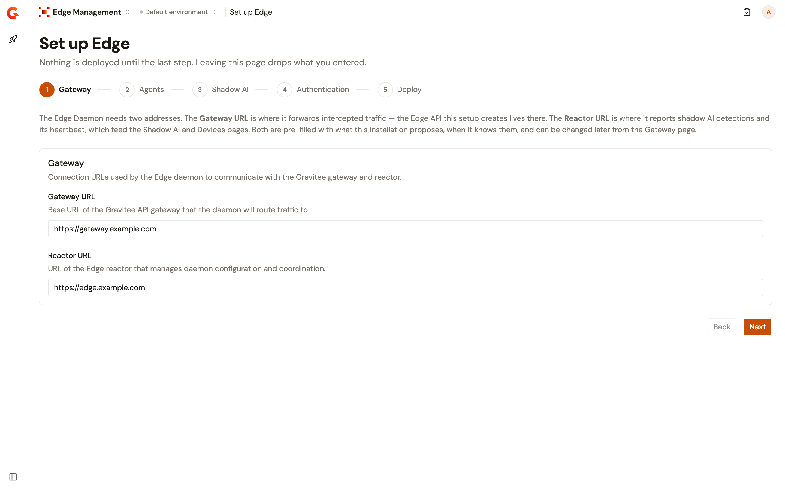
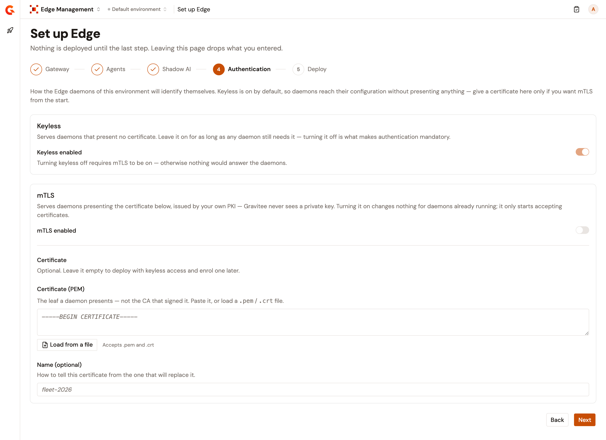
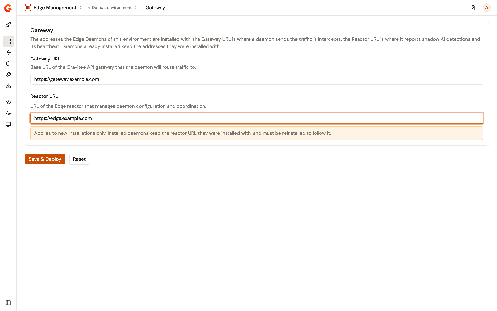

# Set up Edge Management

## Overview

Edge Management is configured per environment, and the configuration is created once, through a guided setup. Until it exists, the module offers a single page, **Quick Start**, which explains what Edge Management does and opens the setup.

<!-- TODO: Screenshot of The Quick Start page of an environment that has no configuration yet -->
<figure><figcaption>
The Quick Start page of an environment that has no configuration yet.
</figcaption></figure>

The setup has five steps: **Gateway**, **Agents**, **Shadow AI**, **Authentication**, and **Deploy**. Nothing is deployed until the last step, you can move back and forth with **Back** and **Next**, and leaving the page drops what you entered.

After the setup, each part of the configuration is edited on its own page and saved on its own, so a change to one part never re-sends another.

## Before you start

* An environment of the Gamma console with Edge Management enabled.
* The permission to update the Edge configuration. The default `EDGE_MANAGER` environment role grants it. Without it, Quick Start tells you to ask an administrator to set up Edge for the environment, and the configuration pages are shown read-only.
* The two gateway-side addresses the daemons will use. See [Gateway-side requirements](../get-started/edge-management-overview.md#gateway-side-requirements).

To set up Edge Management, complete the following steps:

1. [Enter the gateway addresses](#enter-the-gateway-addresses)
2. [Choose the agents to intercept](#choose-the-agents-to-intercept)
3. [Choose the domains to watch for shadow AI](#choose-the-domains-to-watch-for-shadow-ai)
4. [Choose how the daemons authenticate](#choose-how-the-daemons-authenticate)
5. [Review and deploy](#review-and-deploy)

## Enter the gateway addresses

1. Open **Edge Management**.
2. On the **Quick Start** page, click **Set up Edge Management**.
3. Enter the two addresses that every Edge Daemon of the environment is installed with. When your installation proposes an address, the setup fills in its field with it.

<figure><figcaption>
Step 1 of the guided setup.
</figcaption></figure>

The following table describes each field:

| Field           | Description                                                                                                                                                                                                                                   |
| --------------- | --------------------------------------------------------------------------------------------------------------------------------------------------------------------------------------------------------------------------------------------- |
| **Gateway URL** | Base URL of the Gravitee API gateway that the daemon routes traffic to. The Edge API published for this environment is served from there, and it applies your policies, quotas, and analytics before the request reaches the AI provider. |
| **Reactor URL** | URL of the Edge Reactor. The daemon reports its heartbeat and the AI providers the device reached directly there, which is what fills the **Detected Shadow AI** and **Devices** pages.                                                    |

Both addresses are required, and both must start with `http://` or `https://`.


**Daemons keep the addresses they were installed with.** Both addresses stay editable on the **Gateway** page, but a change only applies to the daemons installed after it. What the devices are installed with is decided on the **Daemon deployment** page.


4. Click **Next**.

## Choose the agents to intercept

An intercepted agent is an AI coding tool whose traffic the daemon captures: the domains it calls, the routes under those domains, and for each route the target API on the gateway that receives the traffic.

<!-- TODO: Screenshot of Step 2 of the guided setup -->
<figure><figcaption>
Step 2 of the guided setup.
</figcaption></figure>

1. Click **Set up** on the **Claude Code** card, or on the **Custom agent** card for any other tool. The **Codex** card is listed as coming soon and can't be configured.
2. Map each route to its target API, or create the target API from the picker. Everything this form offers is described in [Configure interception](configure-edge-management.md), which is also where you come back to change it later.
3. Click **Done** to hand the agent to the setup.
4. Click **Next**.

You can leave this step empty and configure agents afterward from the **Interception** page. An environment with no intercepted agent intercepts nothing.

## Choose the domains to watch for shadow AI

Shadow AI is traffic that reaches an AI provider directly, bypassing the gateway. Each daemon watches for connections to the domains you list here and reports what it sees.

<!-- TODO: Screenshot of Step 3 of the guided setup -->
<figure><figcaption>
Step 3 of the guided setup.
</figcaption></figure>

1. Enter a provider domain, for example `api.openai.com`, and click **Add**. Repeat for each domain to watch.
2. Set the **Report interval (seconds)**. The default is 120 seconds and the minimum is 10 seconds.
3. Click **Next**.

The following table describes each field:

| Field                         | Description                                                                                                                                  |
| ----------------------------- | -------------------------------------------------------------------------------------------------------------------------------------------- |
| **Monitored domains**         | The provider domains to watch for non-proxied connections. Detection is based on TCP connection monitoring. No traffic content is read. |
| **Report interval (seconds)** | How often a daemon aggregates and reports its shadow AI detections.                                                                          |

Detections show up on the **Detected Shadow AI** page. You can leave this step empty and come back later from the **Shadow AI** page, which offers the same two fields and saves on its own.


Watching a domain for shadow AI and intercepting it are independent. Shadow AI detection tells you that a device reached a provider directly. It doesn't route anything, and it doesn't require the provider to be one of your intercepted agents.


## Choose how the daemons authenticate

This step decides how the Edge Daemons of the environment identify themselves to the Edge Reactor. Nothing here is required. By default, keyless is on, so the daemons reach their configuration without presenting anything, and mTLS is off.

<figure><figcaption>
Step 4 of the guided setup.
</figcaption></figure>


**Turning keyless off here refuses every daemon until their certificates reach the Edge Reactor.** By default, the Edge Reactor listener asks the daemons for no certificate, so mTLS authenticates none of them. Secure the listener first, and install the daemons with the certificate. See [Secure the Edge Reactor listener](secure-the-edge-reactor-listener.md) and [Configure daemon authentication](configure-daemon-authentication.md#turn-on-mtls).


1. Optional: To use mTLS from the start, paste the certificate of your fleet in **Certificate (PEM)**, or click **Load from a file**, and turn on **mTLS enabled**.
2. Optional: To serve only the daemons that present that certificate, turn off **Keyless enabled**.
3. Click **Next**.

The certificate is checked as you enter it. A certificate that's refused holds **Next** until you fix it, or until you clear the field and turn off **mTLS enabled**. If the certificate or the methods you chose are refused when the configuration is created, the configuration is still created and deployed. The page then says **The daemon authentication was not applied**. Finish from the **Daemon authentication** page.

For everything this step offers, see [Configure daemon authentication](configure-daemon-authentication.md).

## Review and deploy

The last step lists what will be created.

<!-- TODO: Screenshot of Step 5 of the guided setup -->
<figure><figcaption>
Step 5 of the guided setup.
</figcaption></figure>

1. Check the gateway addresses, the intercepted agents, the shadow AI domains, and the daemon authentication.
2. Click **Create & Deploy**. This publishes an Edge API for the environment, deploys it to the gateway, and applies the daemon authentication you chose in the **Authentication** step.

If an agent's target API can't serve its route yet, a dialog names the agent, the route, and the reason before you commit. It's a warning, not a refusal: click **Create & Deploy anyway** to create the configuration and fix the API afterward, or **Back to configuration** to change the route first. See [Understand the route verdicts](configure-edge-management.md#understand-the-route-verdicts).

<!-- TODO: Screenshot of The warning shown when a route's target API can't serve it yet -->
<figure><figcaption>
The warning shown when a route's target API can't serve it yet.
</figcaption></figure>


**A deployed configuration intercepts nothing until the devices run the daemon.** Creating the configuration publishes the Edge API on the gateway. It doesn't touch a single device. Installing the daemon is a separate procedure.


## Change the gateway addresses

The **Gateway** page shows the two addresses of the configuration and saves a change to either one. A change only applies to the daemons installed after it. A daemon already installed keeps the addresses it was installed with until you install it again from the **Daemon deployment** page.

1. Open **Edge Management**.
2. Click **Gateway**.
3. Change the **Gateway URL**, the **Reactor URL**, or both. Under each address that you change, a warning says that the change applies to new installations only.

<figure><figcaption>
The Gateway page with a changed Reactor URL.
</figcaption></figure>

4. Click **Save & Deploy**. This saves both addresses and deploys the Edge API of the environment again. To discard your changes instead, click **Reset**.

When your installation proposes an address other than the one in the field, the page shows the proposed address under the field, with where it comes from. The address you save stays in use, whatever the installation proposes. The **Gateway URL** that the installation proposes is the gateway access point of the environment. Without one, it's the **Default HTTP entrypoint** that the **Entrypoints & Sharding Tags** page sets for the environment, unless that's still the default, `https://api.company.com`. To set the **Reactor URL** that the installation proposes, see [Propose the Reactor URL to Edge Management](configure-edge-ingress.md#propose-the-reactor-url-to-edge-management).

Both addresses are required, and both must start with `http://` or `https://`. Without the permission to update the Edge configuration, the page is read-only.

## Next steps

* **Install the daemon on your devices.** The **Daemon deployment** page carries the download URL for each architecture, a ready-made post-install script for Iru (formerly Kandji), and the commands to check that the daemon runs. See [Configure Iru to deploy the Edge Daemon](configure-kandji-daemon.md).
* **Configure interception.** Map each agent's routes to the target APIs that receive their traffic. See [Configure interception](configure-edge-management.md).
