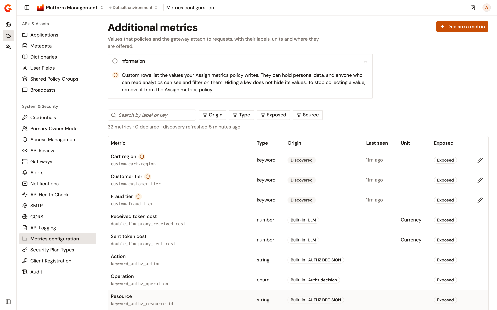
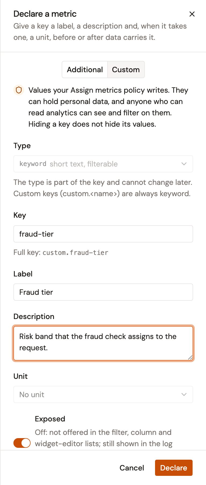

# Configure additional metrics

Additional metrics are values that a policy or the gateway attaches to a request. Custom metrics are the values that the Assign metrics policy writes on a request. Both show in the log detail as soon as requests carry them.

The **Metrics configuration** page lists the additional and custom metrics of an environment. For each one, it sets a label, a description, and, for an additional metric, a unit, and whether the filter, column, and widget-editor lists of the Observability pages offer it.

## Open the Metrics configuration page

To open the page, complete the following steps:

1. At the top of the page, click **Home**, or the name of the product you're working in.
2. Select **Platform Management**.
3. Open the **Environment** section. The section names show when you hover over the icons on the left.
4. Under **System & Security**, click **Metrics configuration**.

<!-- TODO: Screenshot of the Metrics configuration page, with built-in, declared, and discovered metrics in the table -->
<figure><figcaption>
The Metrics configuration page
</figcaption></figure>

The page appears only for a role that can read the environment's settings. Without permission to update them, the table is read-only. Opening the **Information** panel above it shows **You do not have permission to modify these settings. Contact your administrator for access.**

## Read the list

The **Additional metrics** table has one row per metric:

| Column | What it shows |
| ------ | ------------- |
| **Metric** | The label, with the key below it. |
| **Type** | The type of the values, such as **number** or **keyword**. **log detail only** follows the type of a metric that only the log detail shows, such as a **string** or **json** value. |
| **Origin** | **Built-in** for a metric that comes with Gravitee, followed by its API type when it belongs to one, **Declared** for a metric that has a record in this environment, and **Discovered** for a metric that requests of the last 30 days carried. |
| **Last seen** | When a request of the last 30 days last carried the metric. A declared or discovered metric without such a date reads **Not in 30 days**. |
| **Unit** | The unit of the values, when the metric has one. |
| **Exposed** | **Exposed**, or **Hidden** for a metric that the filter, column, and widget-editor lists don't offer. |

Discovered metrics and **Last seen** times come from the environment's traffic, so they show only for a user who can read that traffic, such as the logs of one of its APIs. For other users, every declared metric reads **Not in 30 days**.

The scan behind the discovered metrics runs from time to time, and the line above the table says when it last ran. It keeps the 200 most recently seen metrics.

To narrow the table, type in **Search by label or key**, or pick values under **Origin**, **Type**, and **Exposed**. When the table lists custom metrics, **Source** keeps the **Custom** ones or the **Other sources**. **Clear filters** removes the filters.

Built-in metrics can't be edited.

## Declare a metric

Declaring a metric gives it a label, a description, and a unit before any request carries it. To declare a metric, complete the following steps:

1. Click **Declare a metric**.
2. Keep **Additional** selected, for a value that a policy or the gateway attaches to requests. **Custom** is for a value that the Assign metrics policy writes. See [Describe a custom metric](#describe-a-custom-metric).
3. Under **Type**, select the type of the values. The type is part of the key and can't change later.
4. Under **Key**, enter the name of the metric, such as `checkout_basket-value`. **Full key** shows the key it makes, such as `additional-metrics.double_checkout_basket-value`.
5. Optional: Enter a **Label** and a **Description**.
6. Optional: Under **Unit**, select a unit, or select **Custom suffix** and enter the suffix, such as `€`.
7. Optional: Turn off **Exposed**. See [Hide a metric from the lists](#hide-a-metric-from-the-lists).
8. Click **Declare**.

<!-- TODO: Screenshot of the Declare a metric panel, with Additional selected and the Type, Key, Label, Description, Unit, and Exposed fields filled in -->
<figure><figcaption>
The Declare a metric panel
</figcaption></figure>

**Metric declared** confirms the save, and the metric shows as **Declared**. Until a request carries it, its **Last seen** reads **Not in 30 days**.

The **Type** list offers the following types:

| Type | Values |
| ---- | ------ |
| `long` and `int` | Whole numbers |
| `double` | Decimal numbers |
| `bool` | True or false |
| `keyword` | Short text, which the filters offer |
| `string` | Free text, shown in the log detail only |
| `json` | Structured values, shown in the log detail only |

The **Unit** list offers **No unit**, **Custom suffix**, and the following units. The list shows each unit with its suffix, unless the suffix repeats the name.

| Unit | Suffix |
| ---- | ------ |
| **Percent** | `%` |
| **Milliseconds** | `ms` |
| **Seconds** | `s` |
| **Bytes** | `B` |
| **Kilobytes** | `KB` |
| **Megabytes** | `MB` |
| **Gigabytes** | `GB` |
| **Count** | None |
| **Count per second** | `/s` |
| **Tokens** | `tokens` |
| **Currency** | None |

The form refuses a value that breaks one of the following rules, and shows the message under the field:

| Rule | Message |
| ---- | ------- |
| The key holds letters, digits, `-`, `_`, `.`, and `/` only. | **Letters, digits, -, \_, . and / only** |
| The full key is 256 characters at most. | **The key is longer than 256 characters** |
| The key doesn't start with `custom_`. | **Keys starting with `custom_` are reserved** |
| No built-in metric reads the key. | **A built-in metric already uses this key** |
| The environment doesn't have a record on the key yet. | **Already declared in this environment** |
| The label is 64 characters at most. | **Label is longer than 64 characters** |
| The description is 512 characters at most. | **Description is longer than 512 characters** |
| The custom suffix is 16 characters at most. | **Unit is longer than 16 characters** |

## Edit a metric

You can edit a declared or a discovered metric, except one whose key, after its type, starts with `custom_` or `custom.`, which is kept for custom metrics. To edit a metric, complete the following steps:

1. Click its row.
2. Change the **Label**, the **Description**, the **Unit**, or **Exposed**. The key and the type can't change.
3. Click **Save**.

Saving a discovered metric creates its record, so it becomes a declared metric. **Record created** confirms it, and **Metric saved** confirms the save of a declared metric.

## Hide a metric from the lists

When **Exposed** is off, the metric shows as **Hidden**, and the filter, column, and widget-editor lists of the Observability pages don't offer it. The log detail still shows it, you can still use it by its key, and saved widgets keep working.

To hide a metric, open it, turn off **Exposed**, and then click **Save** or **Declare**.

## Delete a record

Deleting the record of a declared metric removes its label, its description, its unit, and its visibility setting. The metric is listed as **Discovered** while requests carry it, and disappears otherwise. Saved widgets keep working. To delete a record, complete the following steps:

1. Click the row of the declared metric.
2. Click **Delete record**.
3. In the **Delete this record?** dialog, click **Delete record**.

**Record deleted** confirms the deletion.

## Describe a custom metric

The key of a custom metric is `custom.` followed by the name of the metric in the Assign metrics policy, such as `custom.fraud-tier`. Its values are always text, of type **keyword**, and it belongs to no API type. For more information about the policy, see [Assign Metrics](https://documentation.gravitee.io/apim/create-and-configure-apis/apply-policies/policy-reference/assign-metrics).

In the table, a custom metric shows a **Personal data** badge next to its label, and the **Information** panel has a note about custom metrics. Their values can hold personal data, and anyone who can read the analytics can see them and filter on them. Hiding a custom metric keeps it out of the lists, but doesn't hide its values. To stop collecting a value, remove it from the Assign metrics policy.

<figure><figcaption>
Custom metrics on the Metrics configuration page
</figcaption></figure>

To declare a custom metric, complete the following steps:

1. Click **Declare a metric**.
2. Select **Custom**. **Type** shows **keyword**, and **Unit** is unavailable.
3. Under **Key**, enter the name of the metric in the Assign metrics policy, such as `fraud-tier`. **Full key** shows the key it makes, such as `custom.fraud-tier`. A key entered with `custom.` at the start selects **Custom** and drops `custom.` from the field.
4. Optional: Enter a **Label** and a **Description**.
5. Optional: Turn off **Exposed**. See [Hide a metric from the lists](#hide-a-metric-from-the-lists).
6. Click **Declare**.

<figure><figcaption>
Declaring a custom metric
</figcaption></figure>

The label and the description follow the same rules as for an additional metric. The form refuses a name that breaks one of the following rules, and shows the message under the field:

| Rule | Message |
| ---- | ------- |
| The name is 256 characters at most. | **Use a name of 256 characters at most.** |
| The name doesn't start or end with a dot, and has no two dots in a row. | **Use single dots between the parts of the name.** |
| The name holds none of `"`, `\`, and `*`. | **Leave out ", \ and \* in the name.** |
| The name holds no control characters and no broken characters. | **Leave out control characters and broken characters in the key.** |
| The environment doesn't have a record on the key yet. | **Already declared in this environment** |

To edit, hide, or delete the record of a custom metric, follow the steps for an additional metric. A custom metric takes no unit, so **Unit** stays unavailable, and the **Delete this record?** dialog says that the metric loses its label, its description, and its visibility setting. A discovered custom metric whose name breaks these rules is listed, but can't be edited.

## See the metrics from API Management and Agent Management

API Management and Agent Management list the same metrics, read-only, on the **Settings** page of their **Observability** group. Each module leaves out the metrics that belong only to API types it doesn't manage. Custom metrics belong to no API type, so both modules list them. To change a metric, come back to the **Metrics configuration** page.

## Verification

To verify a declared metric, complete the following steps:

1. At the top of the page, click **Platform Management**.
2. Select **API Management**.
3. Under **Observability**, click **Settings**.
4. In **Search by label or key**, enter the label of the metric.

The table lists the metric with its label, unit, and **Declared** origin, with no edit action.
