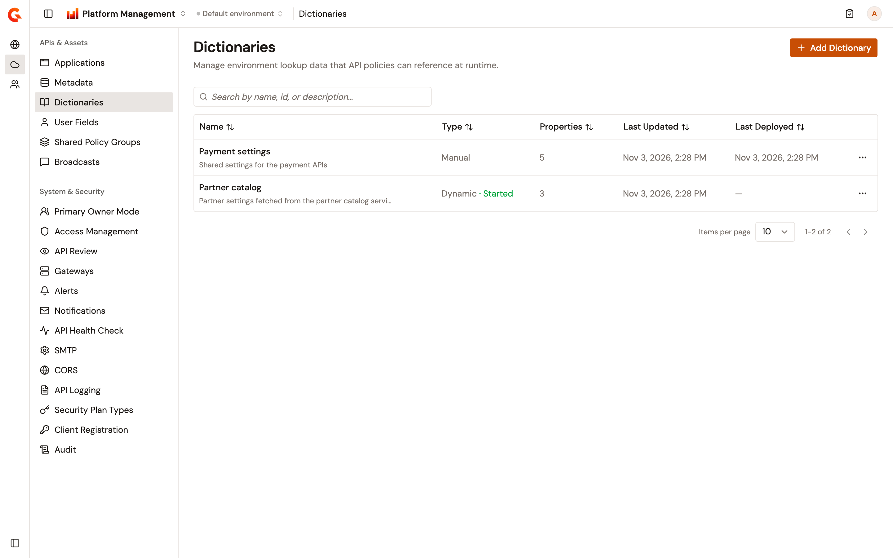
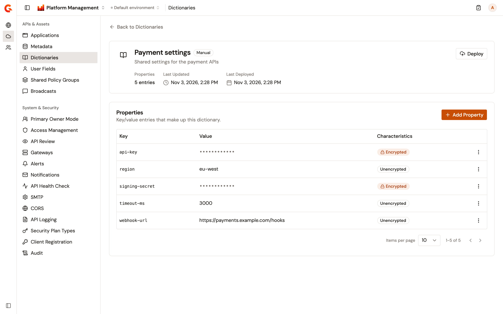
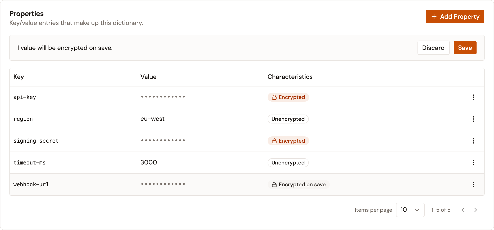
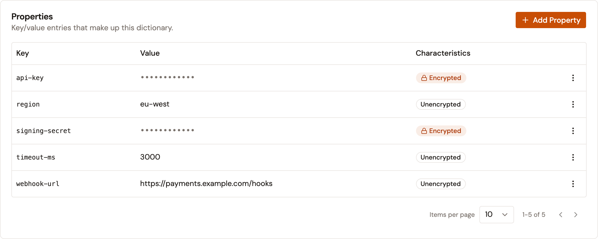

# Manage dictionaries

Dictionaries hold key-value lookup data, called properties, scoped to an environment. API policies reference this data at runtime. The Dictionaries page in the Gamma console lets you view, create, and manage the dictionaries of the selected environment, and encrypt the properties that hold sensitive values.

Every dictionary has one of two types, chosen at creation:

* **Manual**. You maintain the properties by hand and publish them to the gateways with the **Deploy** action.
* **Dynamic**. Gravitee polls an HTTP source at a configured interval and refreshes the properties automatically while the dictionary is started.

## View dictionaries

From the Gamma console sidebar, select **Platform Management**, and then navigate to **Dictionaries**.

The dictionaries table displays the following columns:

* **Name**. The dictionary name and its description. Select the name to open the dictionary's detail page.
* **Type**. Manual or Dynamic. For a dynamic dictionary, the current state, Started or Stopped, appears next to the type.
* **Properties**. The number of properties the dictionary holds.
* **Last Updated**. When the dictionary configuration last changed.
* **Last Deployed**. When a manual dictionary was last deployed. This column doesn't apply to dynamic dictionaries.
* **Actions**. A row menu that contains the **View Details**, **Edit**, and **Delete** actions.

Use the search bar to filter dictionaries by name, ID, or description. The table supports sorting and pagination.

<figure><figcaption>
The Dictionaries page lists the dictionaries of the selected environment with their type, property count, and deployment dates.
</figcaption></figure>

## Create a dictionary

To create a dictionary, complete the following steps:

1. From the dictionaries list, select **Add Dictionary**.
2. Enter the dictionary details described in the following table:

    | Field           | Description                                                                                                                | Required |
    | --------------- | -------------------------------------------------------------------------------------------------------------------------- | -------- |
    | **Name**        | A human-readable name of 3 to 50 characters. A name that another dictionary in the environment already uses is rejected.   | Yes      |
    | **Description** | Freeform text describing the dictionary's purpose.                                                                          | No       |
    | **Type**        | **Manual** or **Dynamic**. The type is fixed after creation.                                                                | Yes      |

3. For a dynamic dictionary, configure the **Trigger** and **HTTP Provider** sections described in the following tables.

    The **Trigger** section defines how often the provider is polled to refresh the properties:

    | Field         | Description                                | Required |
    | ------------- | ------------------------------------------ | -------- |
    | **Interval**  | A whole number greater than 0.             | Yes      |
    | **Time Unit** | **Seconds**, **Minutes**, or **Hours**.    | Yes      |

    The **HTTP Provider** section defines the source of the properties:

    | Field                  | Description                                                                                                          | Required |
    | ---------------------- | -------------------------------------------------------------------------------------------------------------------- | -------- |
    | **HTTP Service URL**   | The `http` or `https` URL that returns the dictionary data.                                                          | Yes      |
    | **HTTP Method**        | GET, POST, PUT, PATCH, or DELETE. Defaults to GET.                                                                    | No       |
    | **Use system proxy**   | Whether to send provider requests through the system proxy.                                                           | No       |
    | **Request body**       | A body sent with each provider request.                                                                               | No       |
    | **Headers**            | Name and value pairs sent with each provider request. Select **Add** to add a header row.                             | No       |
    | **JOLT Specification** | A JOLT transform that converts the HTTP response into the dictionary's key-value properties. A default is pre-filled. | Yes      |

4. Optional: for a dynamic dictionary, select **Encrypt fetched values** to encrypt every value that the dictionary fetches from its provider.
5. Select **Create**.

The console creates the dictionary and redirects you to its detail page. A new dynamic dictionary starts in the Stopped state and doesn't poll its provider until you start it.

## Add properties to a manual dictionary

To add properties to a manual dictionary, complete the following steps:

1. From the dictionaries list, select the dictionary name to open its detail page.
2. In the **Properties** section, select **Add Property**.
3. Enter the **Key** and the **Value**. Property keys are unique within a dictionary, and a duplicate key is rejected.
4. Optional: turn on **Encrypt on save** to store the value encrypted.
5. Select **Add**.

A property added with **Encrypt on save** is saved only when you select **Save** above the properties table. For more information, see [Encrypt property values](#encrypt-property-values).

Edit or delete an existing property from its row in the properties table. An encrypted value can't be edited, only replaced. Changes to the properties reach the gateways when you deploy the dictionary.

<figure><figcaption>
The detail page of a manual dictionary. Add, edit, or delete properties, then select Deploy to publish them to the gateways.
</figcaption></figure>

## Encrypt property values

Encrypt the properties that hold sensitive values, such as passwords or API keys. A dictionary holds encrypted and unencrypted properties side by side. After you save, the console masks an encrypted value and never shows it again, while policies still read the original value at runtime.

To encrypt existing properties, complete the following steps:

1. From the dictionaries list, select the dictionary name to open its detail page.
2. In the properties table, open the actions menu of the property.
3. Select **Encrypt**. The property shows **Encrypted on save**, and a bar above the table shows how many values will be encrypted on save.
4. Repeat steps 2 and 3 for each property to encrypt.
5. In the bar, select **Save**.

<figure><figcaption>
A property marked for encryption, before you save
</figcaption></figure>

Nothing is saved until you select **Save**. Until then, select **Do not encrypt** in the actions menu of a property to keep it unencrypted, or select **Discard** to cancel all the encryptions. **Discard** also removes the new properties added with **Encrypt on save**. On a new property, **Do not encrypt** adds the property unencrypted right away.

An encrypted value can't be turned back into plain text:

* To change an encrypted value in a manual dictionary, select **Replace value** in its actions menu, enter the new value, and then select **Replace**. The new value is encrypted.
* To store a manual dictionary property unencrypted again, delete the property, and then add it again with **Encrypt on save** turned off.

A dynamic dictionary takes its values from its provider. Encrypt an unencrypted property from its actions menu, and then select **Save**. An encrypted property has no actions. When the provider sends a new value for an encrypted property, the new value is encrypted too.

To encrypt every value that a dynamic dictionary fetches, select **Encrypt fetched values** when you create or edit the dictionary. Values that aren't encrypted yet are encrypted the next time they're fetched. Clearing **Encrypt fetched values** doesn't decrypt the values that are already encrypted.

Policies read the original value of an encrypted property only when your gateways use the same encryption secret as your installation, which is the case by default. Otherwise, policies read the encrypted value. For more information, see [Property Encryption](https://documentation.gravitee.io/apim/prepare-a-production-environment/production-best-practices/general-recommendations/property-encryption).

## Deploy a manual dictionary

Deploying publishes the current properties of a manual dictionary to the gateways. To deploy a manual dictionary, complete the following steps:

1. From the dictionaries list, select the dictionary name to open its detail page.
2. Select **Deploy**.

The **Last Deployed** timestamp updates. The **Deploy** action applies only to manual dictionaries: a dynamic dictionary publishes its properties automatically each time it refreshes them from the provider.

## Start and stop a dynamic dictionary

A dynamic dictionary refreshes its properties only while it's started. To start it, complete the following steps:

1. From the dictionaries list, select the dictionary name to open its detail page.
2. Select **Start**.

While the dictionary is started, Gravitee polls the HTTP provider at the configured interval. Each refresh updates the properties and publishes them to the gateways. The **Properties** section of a dynamic dictionary fills once the dictionary is started. Its values come from the provider, so they can't be added, edited, or deleted, only encrypted.

Select **Stop** to halt the refresh cycle.

The detail page of a dynamic dictionary also shows a **Trigger & Provider** section. It summarizes the polling interval, the provider URL and method, whether fetched values are encrypted, the headers, the request body, and the JOLT specification.

## Edit a dictionary

To edit a dictionary, complete the following steps:

1. In the dictionary's row, open the actions menu.
2. Select **Edit**.
3. Update the name, the description, and, for a dynamic dictionary, the trigger, the HTTP provider settings, and **Encrypt fetched values**. The type is read-only.
4. Select **Save Changes**.

Edits to a started dynamic dictionary take effect without stopping it.

## Delete a dictionary

To delete a dictionary, complete the following steps:

1. In the dictionary's row, open the actions menu.
2. Select **Delete**.
3. In the confirmation dialog, select **Delete Dictionary**. Deleting a dictionary permanently removes all its properties and also removes it from the gateways.

## Verification

To verify dictionary encryption is working as expected, follow these steps:

1. From the dictionaries list, select the dictionary name to open its detail page.
2. In the properties table, check that the property shows **Encrypted** and that its value is masked.

<figure><figcaption>
Encrypted properties, masked, next to unencrypted properties
</figcaption></figure>

## Next steps

* [Manage applications](manage-applications.md). Manage the consumer applications that subscribe to your API plans.
