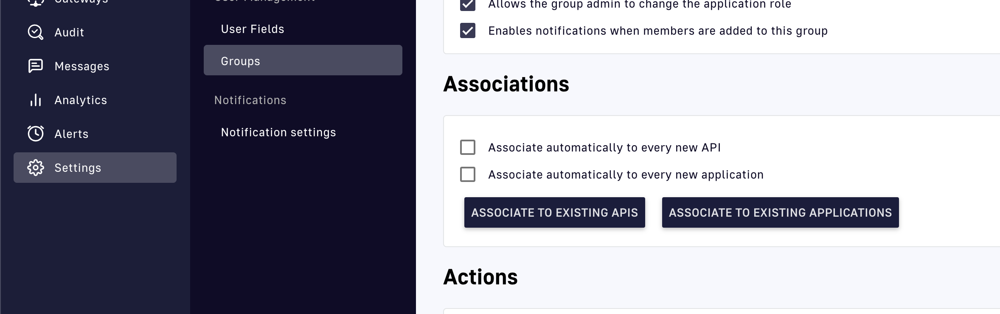

# Manage API and application groups and members

`ApiV4Definition`, `ApiDefinition`, and `Application` CRDs all support the configuration of user permissions. This means that you can define the groups and members that can or cannot access a specific API or application in APIM, and do this declaratively from a CRD.

## Configuring groups and members

The syntax is the same for `ApiV4Definition`, `ApiDefinition`, and `Application` CRDs, with groups and members attributes at the root of the spec:

```yaml
 spec:
  groups:
    - developers
    - users
  members:
    - source: gravitee
      sourceId: my.name@bestproducts.com
      role: USER
    - source: gravitee
      sourceId: another.name@amce.com
      role: WRITER
  # [...]
```

Generally speaking, if a group or member referenced from an API or application does not exist in APIM, that group or member is simply ignored and not added to the resource in APIM.

If a role is omitted or cannot be found, for example, due to a typo, the member will be assigned the default role for that specific scope: API or Application. If no default role is defined in the organization settings for that scope, the system will return an error.


For APIs managed by GKO, you will not be able to add or modify groups or members manually from the API Management Console.


## Leave the groups to APIM

To let APIM keep the groups of an API or an application, set the `gravitee.io/ignore-groups` annotation to `"true"` on its `ApiV4Definition` or `Application` resource. The annotation requires APIM 4.14.0 or later, and APIM 4.13 ignores it. It has no effect on an `ApiDefinition` resource.

```yaml
apiVersion: gravitee.io/v1alpha1
kind: ApiV4Definition
metadata:
  name: orders
  annotations:
    gravitee.io/ignore-groups: "true"
spec:
  contextRef:
    name: "dev-ctx"
  name: "orders"
  # [...]
```

With the annotation set to `"true"`, the following rules apply:

* When GKO creates an API, the API receives only the groups that have **Automatically add group to new APIs** turned on in the Console. A new application receives only the groups that have **Automatically add group to new applications** turned on.
* When GKO updates the API or application, it keeps the groups that it has in APIM.
* The resource's `groups` aren't applied, and neither are the `groupRefs` of an `ApiV4Definition`. If the resource declares groups, GKO accepts it with the warning `spec.groups and spec.groupRefs are not applied while gravitee.io/ignore-groups is true` on an `ApiV4Definition`, or `spec.groups is not applied while gravitee.io/ignore-groups is true` on an `Application`.

A change to the annotation takes effect when you apply it, even when the rest of the resource doesn't change. To manage the groups from the resource again, remove the annotation or set it to `"false"`. When you apply the change, GKO applies the resource's groups again.

## Limitations

In the Gravitee API Management Console, there are environment-level settings that you can use to automatically assign groups to every new API or application that a user creates. These settings are shown in the following screenshot.

<figure><figcaption></figcaption></figure>

Starting from 4.7.4, this feature has been made available for APIs and applications managed by the Kubernetes Operator as well.

However, the operator handles resources declaratively. If you disable automatic associations in the management UI, groups added to APIs or applications by this feature are removed whenever the Kubernetes resource is updated. To avoid this issue, add the group to the resource before performing the update. With APIM 4.14.0 or later, you can instead set the `gravitee.io/ignore-groups` annotation on an `ApiV4Definition` or `Application` resource, so that it keeps its groups. For more information, see [Leave the groups to APIM](#leave-the-groups-to-apim).
