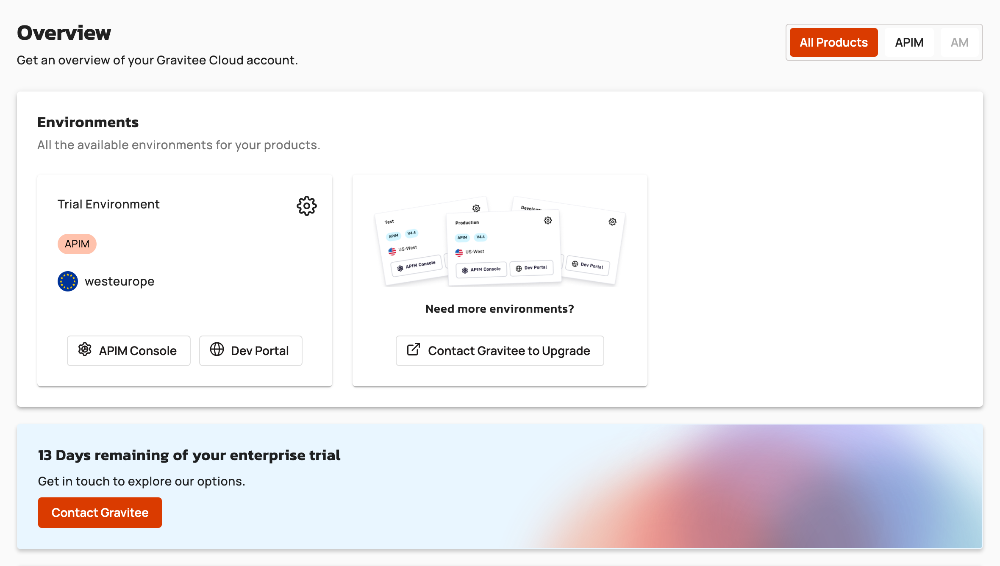

# Access your environments

## Overview

The **Environments** section of the Gravitee Cloud **Dashboard** lists the environments of your account that you have access to. From each environment, you open its APIM Console, its Developer Portal, or, when your account has access to Gamma, its Gamma console. On a trial account, the **Dashboard** also shows how many days remain in your trial.

## Open the APIM Console, Developer Portal, or Gamma console

To open the APIM Console, the Developer Portal, or the Gamma console of an environment, complete the following steps:

1. In Gravitee Cloud, open **Dashboard**.
2. In the **Environments** section, click one of the following buttons on the environment:
   * **APIM Console**
   * **Dev Portal**
   * **Gamma Console**. This button appears only when your account has access to Gamma.

The APIM Console, the Developer Portal, or the Gamma console of the environment opens in a new browser tab. If it's unreachable, a message that starts with `Unable to reach` appears instead, and no tab opens.

When the **Environments** section shows your environments as a list, the buttons are in the **Direct Access** column.

## Check the days remaining in your trial

On a trial account, the **Dashboard** shows how many days remain in your enterprise trial. When no days remain, it shows **Your enterprise trial has expired**.

To upgrade your trial, click **Contact Gravitee**. The Gravitee contact page opens in a new browser tab. For more information, see [Upgrading your trial to a customer account](upgrading-your-trial-to-a-customer-account.md).

## Verification

To verify that environment access is working as expected, follow these steps:

1. In Gravitee Cloud, open **Dashboard**.
2.  The **Environments** section lists the environments you have access to, each with an **APIM Console** button and a **Dev Portal** button. On a trial account, the days remaining in your enterprise trial also appear.

    <figure><figcaption>
Dashboard of a trial account
</figcaption></figure>
