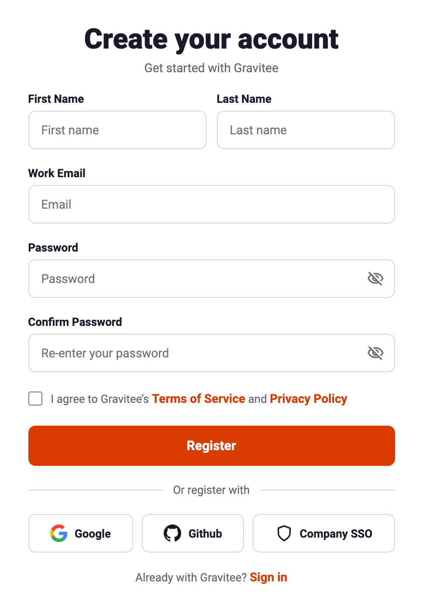
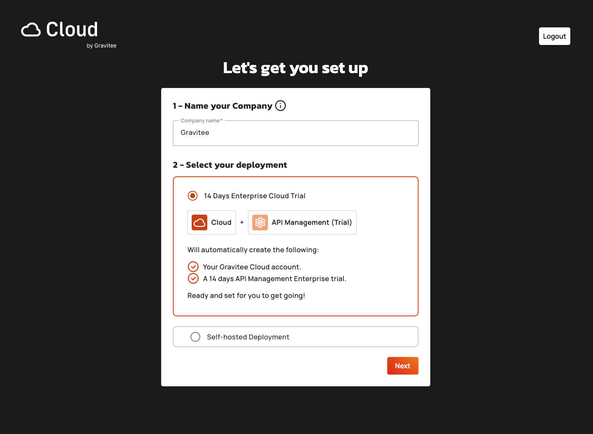
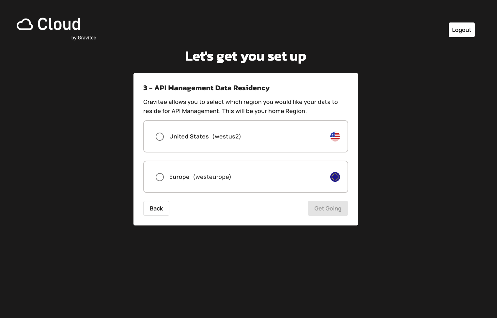
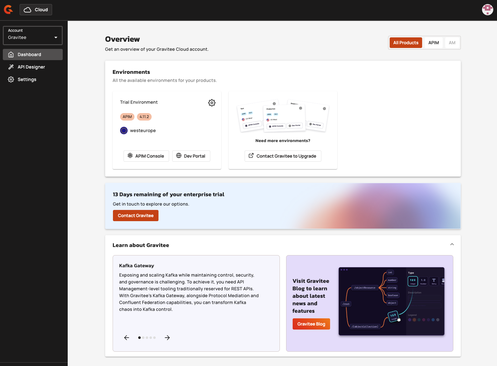

# Getting started with Gravitee Cloud

To get started with Gravitee Cloud, complete the following steps

**Step 1** - Go to [Gravitee Cloud](https://cloud.gravitee.io), and then click **Sign up**. Fill in the **Create your account** form, select the checkbox to agree to the Terms of Service and Privacy Policy, and then click **Register**. To sign up with your Google or GitHub account instead, click its button under **Or register with**.

<figure><figcaption></figcaption></figure>

**Step 2** - If you signed up with the form, check your inbox for the confirmation email, and then click the link in it to confirm your email address. Confirm your email address before you sign in, and then [sign in to Gravitee Cloud](sign-in-to-gravitee-cloud.md).


If the email doesn't arrive within a few minutes, check your spam folder.


**Step 3** - Name your cloud account

**Step 4** - Choose _14 days Enterprise trial_ as the deployment option. The trial is your first stepping stone into Gravitee Cloud. 

<figure><figcaption></figcaption></figure>

**Step 5** - Select the data residency you want. Gravitee allows you to select the region where you would like your data to reside for API Management.&#x20;

<figure><figcaption></figcaption></figure>

**Step 6** - Click on _"Get Going"_

You are then directed to the Gravitee Cloud Dashboard, where you can discover your options in Gravitee Cloud UI or go straight into API Management Control Plane by accessing APIM Console or Dev Portal.

<figure><figcaption></figcaption></figure>

For more information about the **Environments** section of the **Dashboard**, see [Access your environments](access-your-environments.md).
