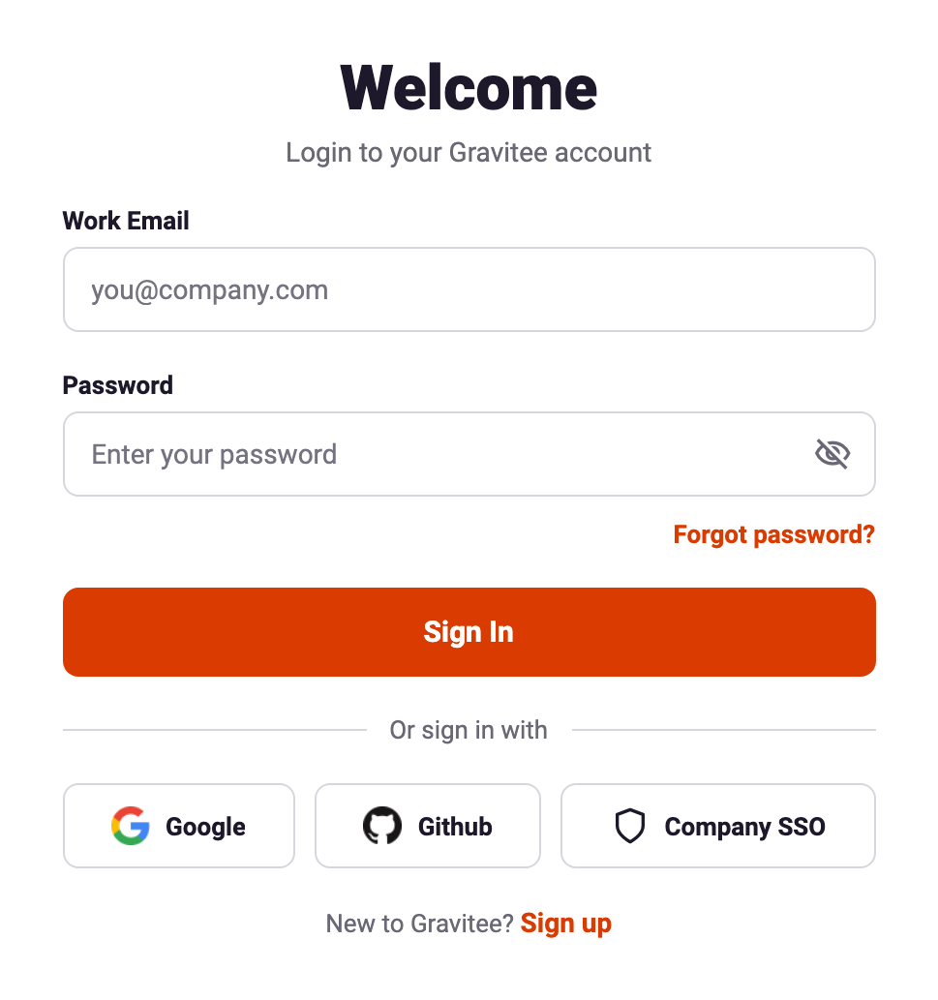
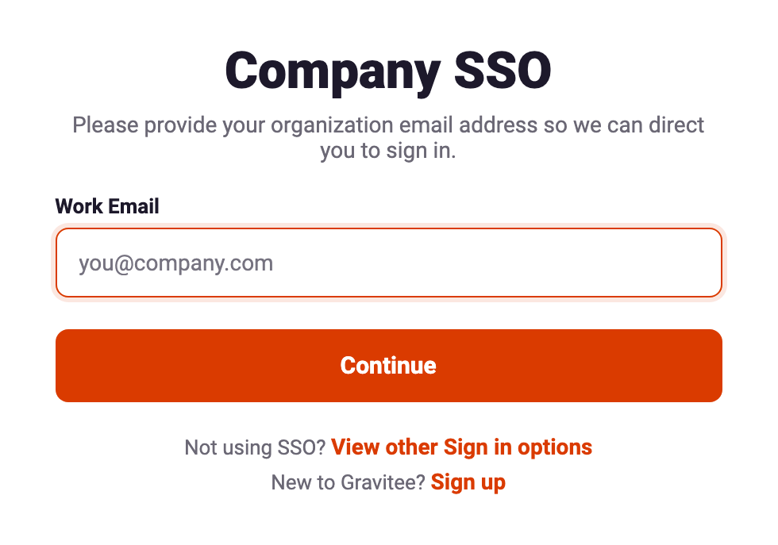
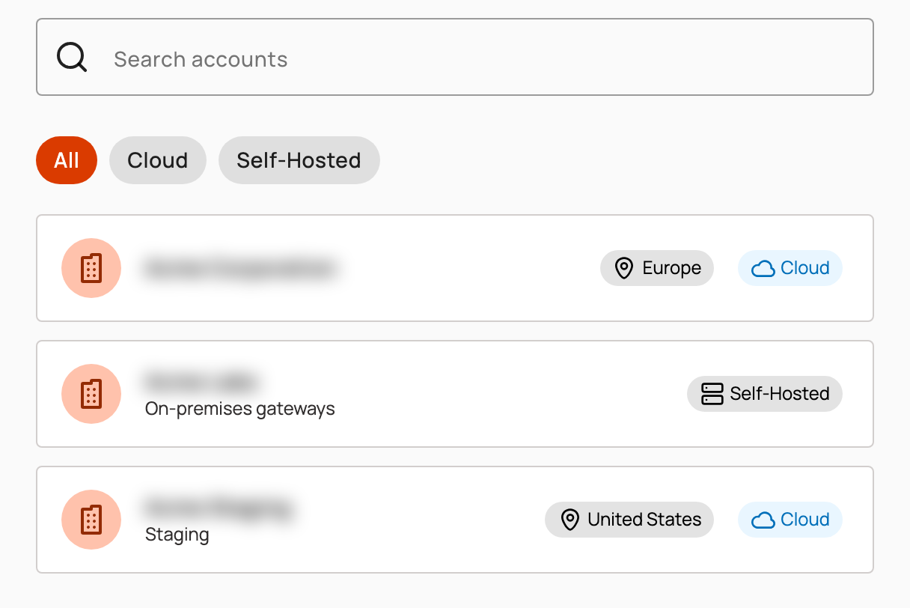
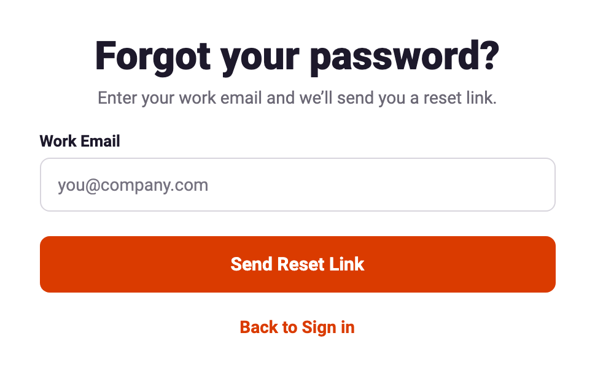
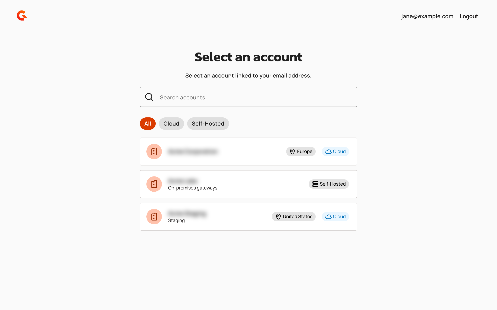

# Sign in to Gravitee Cloud

## Overview

Sign in to Gravitee Cloud with your work email and password, with a Google or GitHub account, or with your company's single sign-on. When your email address is linked to more than one Gravitee Cloud account, you choose the account to open after you sign in.

## Sign in

To sign in to Gravitee Cloud, complete the following steps:

1. Go to [Gravitee Cloud](https://cloud.gravitee.io).
2. In **Work Email**, enter your work email address.
3. In **Password**, enter your password.
4.  Click **Sign In**.

    <figure><figcaption>
Sign-in page
</figcaption></figure>

To sign in with your Google or GitHub account instead, click its button under **Or sign in with**. To sign in with your company's single sign-on, see [Sign in with Company SSO](#sign-in-with-company-sso).

When your email address is linked to one account, the dashboard of that account opens. When it's linked to several accounts, the **Select an account** page opens. For more information, see [Select an account](#select-an-account).

## Sign in with Company SSO

If your company has set up single sign-on for Gravitee Cloud, you sign in on your company's sign-in page. To sign in with Company SSO, complete the following steps:

1. Go to [Gravitee Cloud](https://cloud.gravitee.io).
2. Under **Or sign in with**, click **Company SSO**.
3. In **Work Email**, enter your work email address.
4.  Click **Continue**.

    <figure><figcaption>
Company SSO page
</figcaption></figure>
5. Sign in on your company's sign-in page.

For more information about setting up single sign-on, see [Configure Single Sign On](../guides/configure-sso.md).

## Select an account

When your email address is linked to more than one Gravitee Cloud account, the **Select an account** page opens after you sign in. To open an account, complete the following steps:

1. Optional: To find the account, enter part of its name in **Search accounts**, or click **Cloud** or **Self-Hosted** to list only that type of account.
2.  Click the account.

    <figure><figcaption>
Accounts linked to your email address
</figcaption></figure>

The dashboard of the account opens. To switch to another account later, select it in the **Account** selector at the top of the left menu.

## Reset your password

To reset a forgotten password, complete the following steps:

1. Go to [Gravitee Cloud](https://cloud.gravitee.io).
2. Click **Forgot password?**
3. In **Work Email**, enter your work email address.
4.  Click **Send Reset Link**.

    <figure><figcaption>
Forgot your password? page
</figcaption></figure>
5. Check your inbox, and then click the link in the password reset email.
6. In **New Password**, enter a new password that meets the rules the form lists.
7. In **Confirm Password**, enter the new password again.
8. Click **Reset Password**.

## Accept an invitation

When someone invites you to a Gravitee Cloud account, you receive an email that invites you to join it. The links in the email expire after the time the email states. To accept the invitation, complete the following steps:

1. If you're new to Gravitee Cloud, click **Register** in the invitation email. The sign-up form opens with your email address filled in and locked. Complete the form, and then confirm your email address.
2. In the invitation email, click **Sign in**, and then sign in. You join the account when you sign in.

If the account has single sign-on turned on for the domain of your email address, the invitation email has a **Sign in with SSO** button instead. Click it, click **Continue** on the **Company SSO** page, and then sign in on your company's sign-in page.

## Verification

To verify that sign-in is working as expected, follow these steps:

1. Sign in to Gravitee Cloud.
2.  The **Select an account** page opens with your email address next to **Logout**. When your email address is linked to one account, the dashboard of that account opens instead.

    <figure><figcaption>
Select an account page after sign-in
</figcaption></figure>
