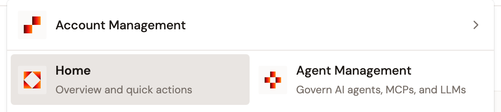
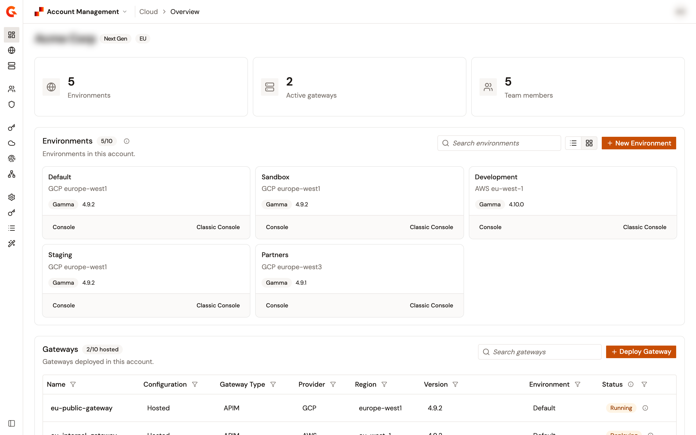
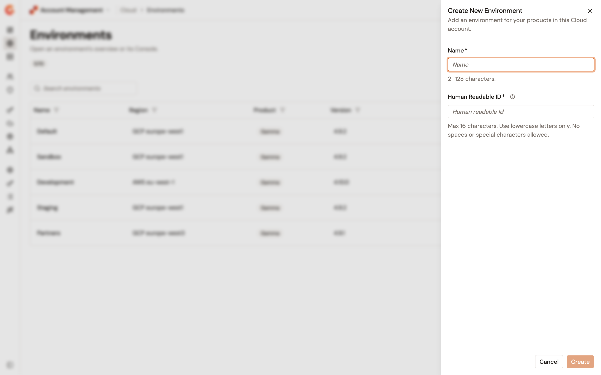
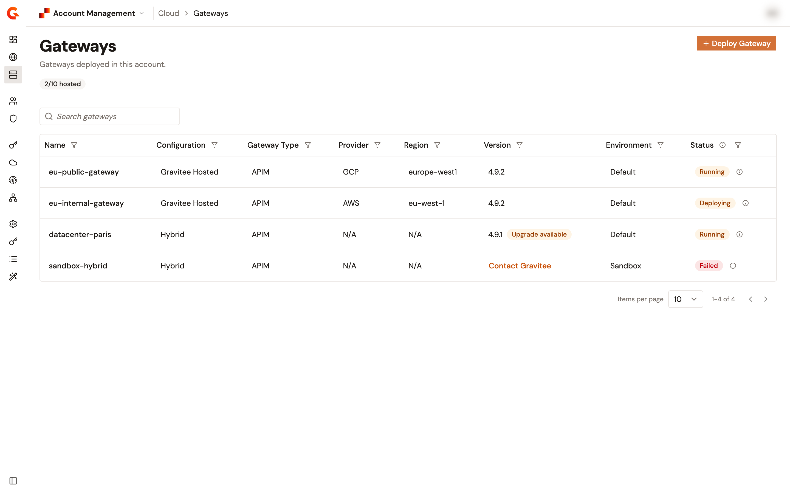
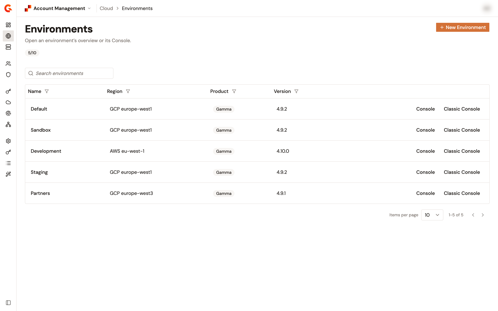

# Use Account Management

<!-- TODO: CJ-5111 held draft. Verify every label after "Open Account Management" against the shipped Account Management, and replace each prototype capture, before merge. -->

## Overview

Account Management is where you see the environments and gateways of your Gravitee Cloud account and create environments. You open it from the Gamma console.

## Open Account Management

To open Account Management, complete the following steps:

1. At the top of the Gamma console, click the name of the app you're in, for example **Home**.
2. Click **Account Management**.

**Account Management** sits on its own row above **Home** and the other apps.

<figure><figcaption>
Account Management above the other apps
</figcaption></figure>

## View the Overview page

Account Management opens on its **Overview** page. The page sums up the environments, gateways, and team members of your account, then lists your environments and gateways.

<!-- TODO: verify label in Console UI, and replace the prototype capture below. -->
<figure><figcaption>
Overview page
</figcaption></figure>

## Create an environment

To create an environment, complete the following steps:

1. In the sidebar of Account Management, click **Environments**.
2. Click **New Environment**.
3. In **Name**, enter a name for the environment.
4. In **Human Readable ID**, check the ID filled in from the name, and change it if needed.
5. Click **Create**.

When your account has reached its environment limit, **New Environment** is unavailable.

<!-- TODO: verify label in Console UI, and replace the prototype capture below. -->
<figure><figcaption>
Create New Environment panel
</figcaption></figure>

## View your gateways

To view the gateways of your account, click **Gateways** in the sidebar of Account Management.

<!-- TODO: verify label in Console UI, and replace the prototype capture below. -->
<figure><figcaption>
Gateways page
</figcaption></figure>

## Verification

To verify that your environment was created, follow these steps:

1. In the sidebar of Account Management, click **Environments**.
2. The environment you created appears in the list.

<!-- TODO: verify label in Console UI, and replace the prototype capture below. -->
<figure><figcaption>
Environments page
</figcaption></figure>
