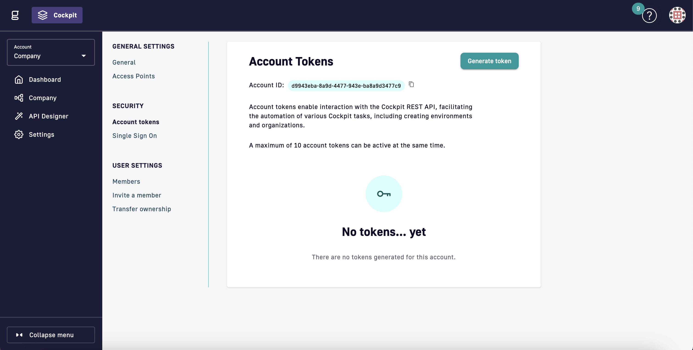
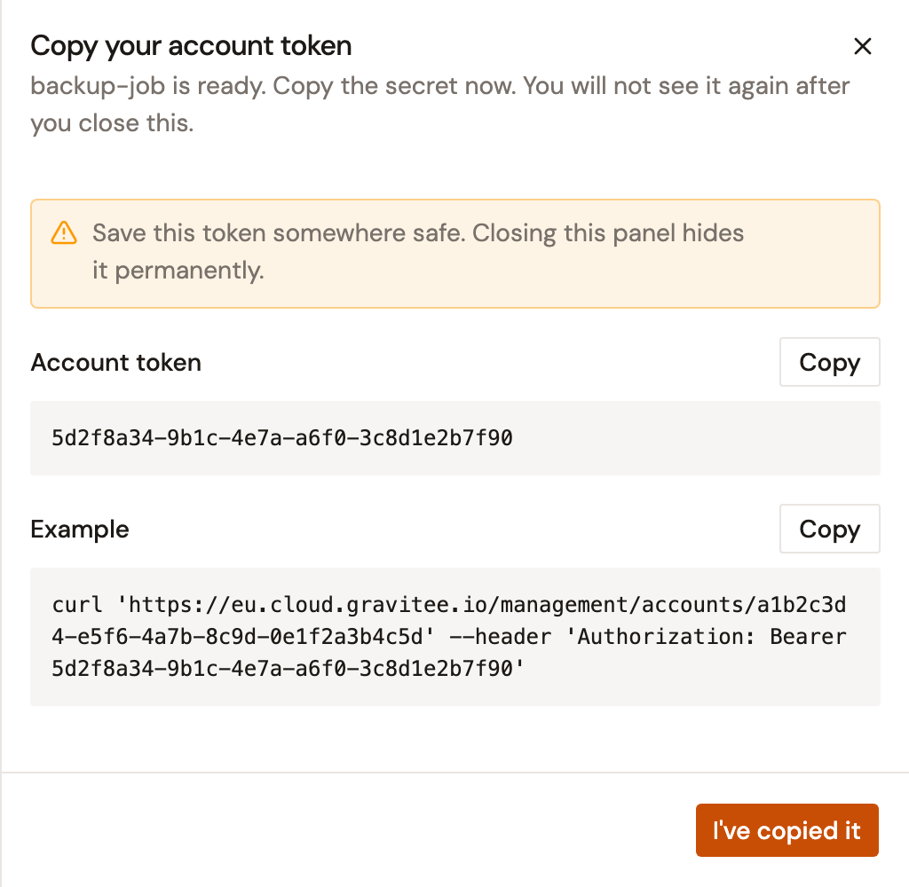
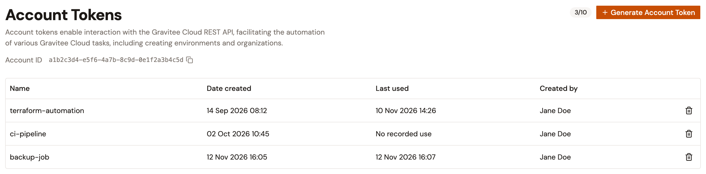

# Account Token

## Introduction

Account Token allows you to generate secure, long-living tokens that can be used to interact with your Cockpit Account via the Management API.

A sample use case would be to automate the creation of Organizations and Environments and then link them to your installations.

## How it works

Account Token management is available through Account Settings to Account Administrators only.

Account Token permissions are directly derived from the user who created the token. For example, if an an ACCOUNT\_PRIMARY\_OWNER creates an Account Token, the token will inherit the account permissions of this user.

A total of 10 Account Tokens can be active simultaneously.

## How to create a token

Follow the steps below to create and manage Account Tokens:

1.  Go to **Settings > Account Tokens**.

    <figure><figcaption></figcaption></figure>
2.  Click **Generate token**, give your Account Token a meaningful name, then click **Generate**.

    <figure><figcaption></figcaption></figure>
3.  The next dialogue box will show your Account Token and a CURL example of how to use it. Make sure to copy your Account Token, as this will not be possible once you close the dialogue box.

    <figure><figcaption></figcaption></figure>
4.  Your Account Token will now be listed in the table.

    <figure><figcaption></figcaption></figure>
5.  To delete a token, click the **trash icon** on the right of the Account Token entry, enter its name in the **Confirm** field, and, after verifying the token has no dependencies, click **I understand the consequences, revoke this token**.

    <figure><figcaption></figcaption></figure>

## Manage account tokens in the Gamma console

In the Gamma console, the **Account Tokens** page of **Account Management** lists the account tokens of your Gravitee Cloud account, and it's where you generate and delete them. The page works on the same tokens as the steps in [How to create a token](#how-to-create-a-token), so a token generated in either place appears in both.

**Account Tokens** appears in the sidebar of **Account Management** only when your role on the account is **Primary Owner** or **Account Owner**. To open the Gamma console, see [Access your environments](../getting-started/access-your-environments.md).

### Generate an account token

To generate an account token, complete the following steps:

1. At the top of the Gamma console, click the name of the current app, for example **Home**.
2. Click **Account Management**.
3. In the sidebar, click **Account Tokens**.
4. Click **Generate Account Token**.
5. In **Name**, enter a name of 3 to 32 characters that no other token of the account uses.
6. Click **Generate**.
7. Next to **Account token**, click **Copy**, and store the token somewhere safe. The token isn't shown again after you close the panel.

    <figure><figcaption>
Copy your account token panel
</figcaption></figure>
8. Optional: Next to **Example**, click **Copy** to get a request that calls the Gravitee Cloud REST API with the token.
9. Click **`I've copied it`**.

A name is refused when another token of the account already uses it, whatever the letter case. So is a name with characters other than Latin letters, digits, spaces, punctuation, and symbols, for example an emoji. When the account already has 10 active tokens, **Generate Account Token** is unavailable until you delete a token.

Requests made with an account token include the ID of your account in their path. The **Account Tokens** page shows it as **Account ID**.

### Delete an account token

To delete an account token, complete the following steps:

1. On the **Account Tokens** page, click the **Delete** icon in the row of the token.
2. Type the name of the token to confirm.
3. Click **Delete token**.

Deleting a token can't be undone. The token is revoked right away, and requests that still use it fail.

### Verification

To verify that your account token works, follow these steps:

1. Run the **Example** request that you copied when you generated the token. The request returns the details of your account.
2. Reload the **Account Tokens** page. The **Last used** value of the token changes from **No recorded use** to the date and time of the request.

<figure><figcaption>
Account Tokens page of Account Management
</figcaption></figure>
