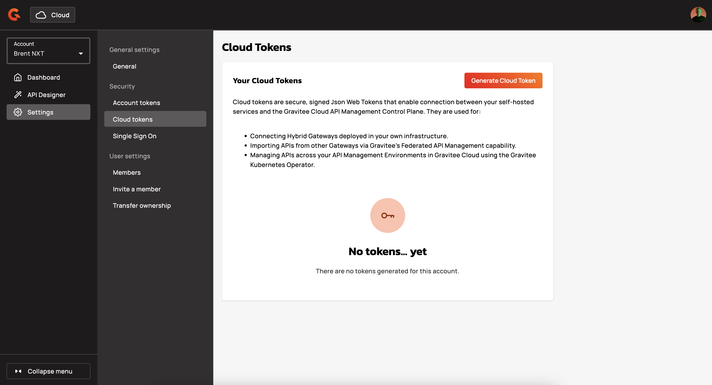
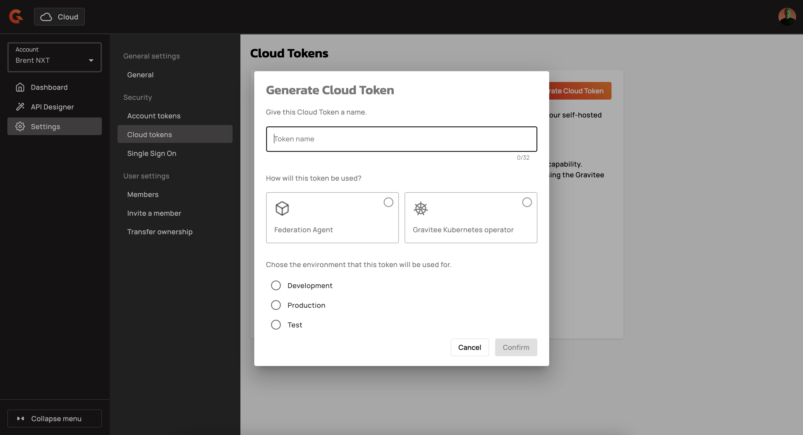
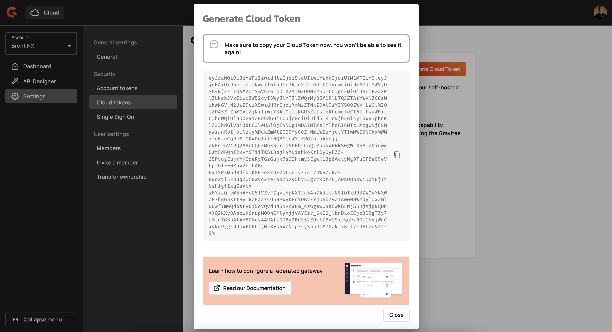
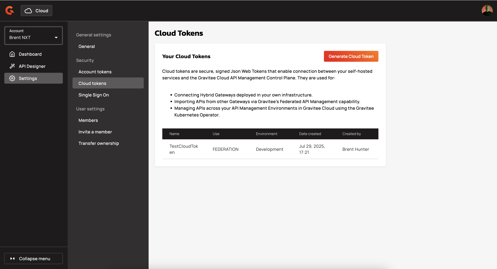
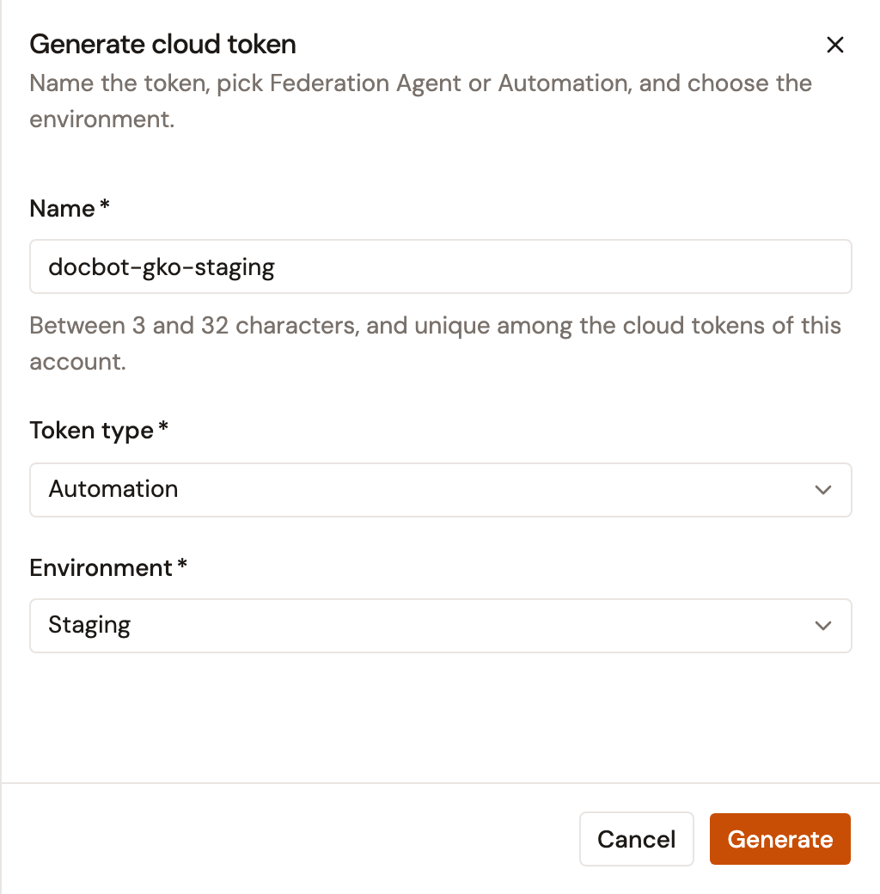
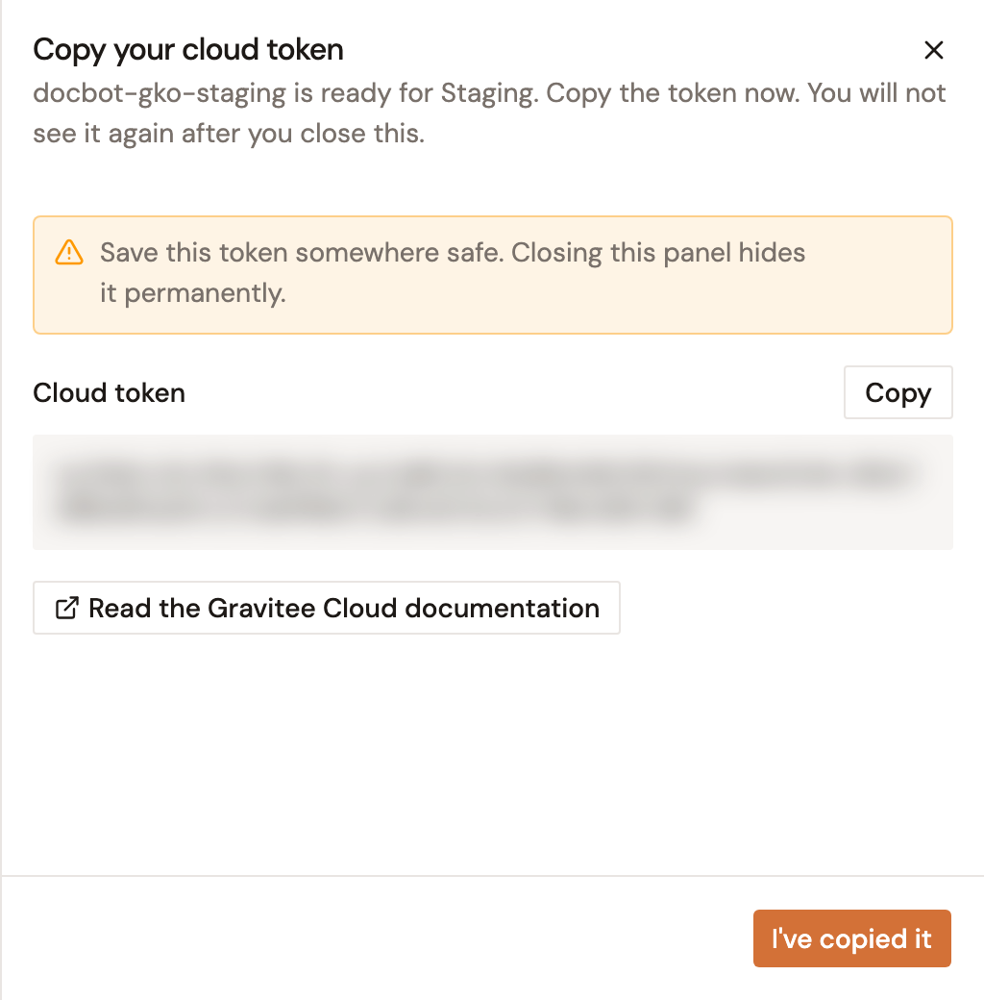
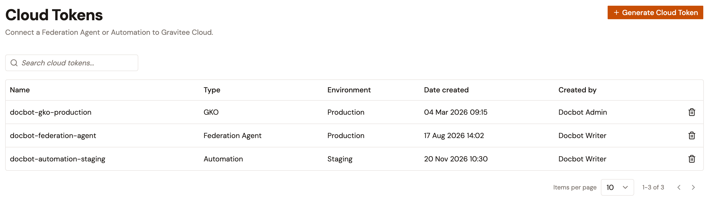

# Cloud Tokens

## Introduction

Cloud tokens are secure, signed Json Web Tokens (JWT) that enable connection between your self-hosted services and the Gravitee Next-Gen Cloud API Management Control Plane. You can use Cloud Tokens to perform the following actions:

* Import APIs from other Gateways via Gravitee’s Federated API Management (APIM) capability.
* Manage APIs across your APIM Environments in Gravitee Cloud via the Gravitee Kubernetes Operator (GKO).

### Where Cloud Tokens are used&#x20;

Cloud Tokens authenticate the following self-hosted components to Gravitee Next-Gen Cloud. In every case, you only need to provide the token: the endpoint, organization, and environment are read from the token's JWT claims.

* **Federation Agent.** A Cloud Token authenticates a Federation Agent that imports APIs from a third-party gateway such as Apigee, AWS API Gateway, Azure API Management, Confluent Platform, IBM API Connect, Mulesoft Anypoint, or Solace. For details, see [Federation Agent Service Account.](https://documentation.gravitee.io/apim/govern-apis/federation/federation-agent-service-account)
* **Gravitee Kubernetes Operator (GKO).** A Cloud Token in a `ManagementContext` resource lets GKO manage APIs across your Cloud environments. For details, see the [GKO quickstart guide.](https://documentation.gravitee.io/gravitee-kubernetes-operator-gko/getting-started/quickstart-guide)
* **Terraform provider.** A Cloud Token authenticates the Gravitee APIM Terraform provider so it can manage Cloud resources as Infrastructure as Code. For details, see the Terraform [quick start guide.](https://documentation.gravitee.io/apim/terraform/quick-start-guide)
* **Hybrid Gateway.** A Cloud Token links a self-hosted hybrid Gateway to the Cloud Control Plane. For details, see [Generate a new Cloud Token.](https://documentation.gravitee.io/apim/hybrid-installation-and-configuration-guides/next-gen-cloud/generate-a-new-cloud-token)


Cloud Token management is available to Account Administrators only.


## Create a Cloud Token

To create a Cloud Token, complete the following steps:

1. Log in to your Cloud Console.
2.  Select **Settings > Cloud tokens** from the menu, and then click **Generate Cloud Token**.

    <figure><figcaption></figcaption></figure>
3.  Give your Cloud Token a meaningful name, select the token type and environment, and then click **Confirm**.

    <figure><figcaption></figcaption></figure>
4.  Save your Cloud Token. You cannot access it once you close the dialog box.

    <figure><figcaption></figcaption></figure>
5.  Verify that your Cloud Token is listed in the table.

    <figure><figcaption></figcaption></figure>


Your Cloud Token can now be used in your Federation Agent configuration file or GKO Management Context file.


### Verification

To verify your Cloud Token was created successfully, follow these steps:

1. In the Cloud Console, select **Settings > Cloud tokens**. The new Cloud Token appears in the table with its name, type, environment, and creation date.

## Manage cloud tokens in the Gamma console

In the Gamma console, the **Cloud Tokens** page of **Account Management** lists the cloud tokens that connect a Federation Agent, the Gravitee Kubernetes Operator, or the Terraform provider to your Gravitee Cloud account, and it's where you generate and delete them. A gateway's cloud tokens are on that gateway's page instead. The page works on the same tokens as the steps in [Create a Cloud Token](#create-a-cloud-token), so a token generated in either place appears in both.

**Cloud Tokens** appears in the sidebar of **Account Management** only when your role on the account is **Primary Owner** or **Account Owner**, and the **Deployment** of the account is **Cloud**. To open the Gamma console, see [Access your environments](../getting-started/access-your-environments.md).

The list shows the oldest token first. To filter it on **Name**, **Type**, **Environment**, or **Created by**, type in the **`Search cloud tokens...`** field. When the user who created a token no longer exists, **Created by** shows **User no longer exists**.

### Generate a cloud token

To generate a cloud token, complete the following steps:

1. At the top of the Gamma console, click the name of the current app, for example **Home**.
2. Click **Account Management**.
3. In the sidebar, click **Cloud Tokens**.
4. Click **Generate Cloud Token**.
5. In **Name**, enter a name of 3 to 32 characters that no other cloud token of the account uses.
6. In **Token type**, select **Federation Agent** for a Federation Agent, or **Automation** for the Gravitee Kubernetes Operator or the Terraform provider.
7.  In **Environment**, select the environment that the token connects to.

    <figure><figcaption>
Generate a cloud token
</figcaption></figure>
8. Click **Generate**.
9.  Next to **Cloud token**, click **Copy**, and store the token somewhere safe. The token isn't shown again after you close the panel.

    <figure><figcaption>
Copy the cloud token
</figcaption></figure>
10. Click **`I've copied it`**.

The form refuses a name that another cloud token of the account already uses, whatever the letter case, and a name with characters that it doesn't accept, and says why. While the account has no environment, **Generate Cloud Token** is disabled and the page says **Create an environment before generating a cloud token.**

The form no longer offers the **GKO** type, which **Automation** replaced. Tokens of that type still appear in the list as **GKO**.

### Delete a cloud token

To delete a cloud token, complete the following steps:

1. On the **Cloud Tokens** page, click the **Delete** icon in the row of the token.
2. Type the name of the token to confirm.
3. Click **Delete token**.

Deleting a token can't be undone. The token is revoked right away, and the self-hosted services that use it lose their connection to Gravitee Cloud. When Gravitee Cloud refuses the deletion, for example while the token still owns APIs or applications, the dialog shows the reason. When the deletion fails for another reason, the dialog shows an error message. Either way, the token stays in the list.

### Verification

To verify that your cloud token was generated, follow these steps:

1.  Open the **Cloud Tokens** page. The token appears in the list with its **Name**, **Type**, **Environment**, **Date created**, and **Created by**.

    <figure><figcaption>
The Cloud Tokens page
</figcaption></figure>
