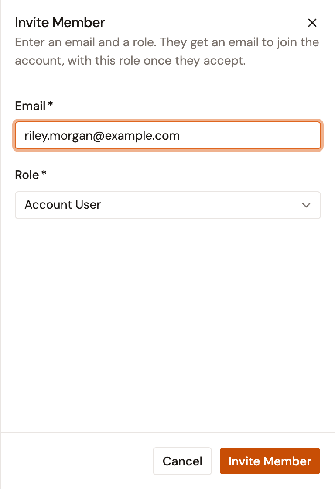
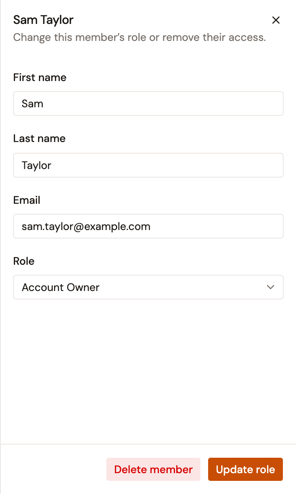
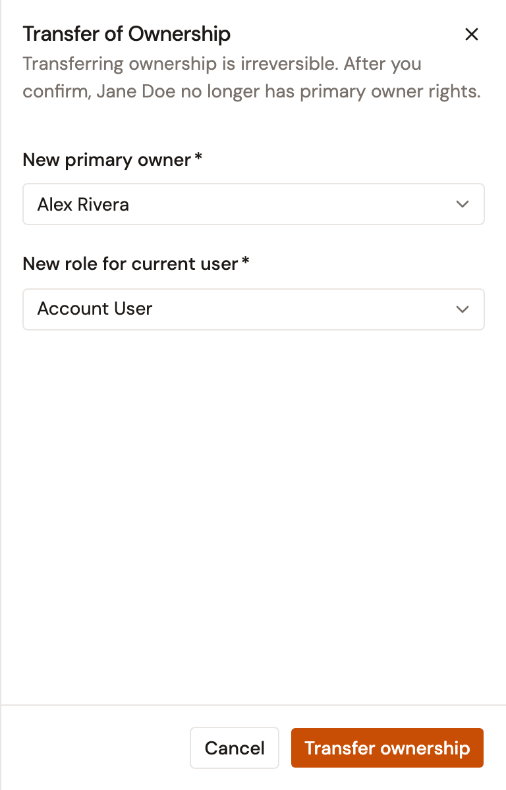
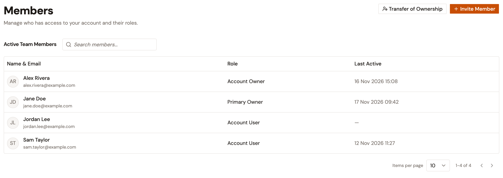

# Manage account members in the Gamma console

## Overview

The **Members** page of **Account Management** in the Gamma console lists the members of your Gravitee Cloud account, with the role of each member and when they were last active. From this page, invite people to the account, change the role of a member, delete a member, and transfer the ownership of the account.

**Members** appears in the sidebar of **Account Management** only when your role on the account gives you access to its members. What you do on the page depends on your role:

* **Primary Owner** or **Account Owner**: invite people, change the role of a member, and delete a member.
* **Primary Owner**: transfer the ownership of the account.
* Any other role: view the page only.

To open the Gamma console, see [Access your environments](../getting-started/access-your-environments.md).

## Open the Members page

To open the **Members** page, complete the following steps:

1. At the top of the Gamma console, click the name of the current app, for example **Home**.
2. Click **Account Management**.
3. In the sidebar, click **Members**.

Search the list by name, email, or role. **Last Active** shows the date and time of the member's last activity in Gravitee Cloud, such as a sign-in. When no activity is recorded for a member, **Last Active** shows a dash.

## Invite a member

To invite someone to the account, complete the following steps:

1. On the **Members** page, click **Invite Member**.
2. In **Email**, enter the email address of the person to invite.
3. In **Role**, select the role the person gets on the account. The default role is **Account User**.
4.  Click **Invite Member**.

    <figure><figcaption>
Invite Member panel
</figcaption></figure>

Gravitee Cloud emails an invitation to the address. The person joins the account with the selected role when they accept the invitation, and then appears on the **Members** page. For the steps the person follows, see [Accept an invitation](../getting-started/sign-in-to-gravitee-cloud.md#accept-an-invitation).

An email address that already belongs to a member of the account is refused. Invitations you send aren't listed on the page. To invite someone again, for example after the link in their email expired, send a new invitation.

## Change the role of a member

To change the role of a member, complete the following steps:

1. On the **Members** page, click the name of the member.
2. In **Role**, select the new role.
3.  Click **Update role**.

    <figure><figcaption>
Panel that opens when you click the name of a member
</figcaption></figure>

When you click your own name or the name of the primary owner, **Role** is read-only. To give the account a new primary owner, see [Transfer the ownership of the account](#transfer-the-ownership-of-the-account).

## Delete a member

To delete a member, complete the following steps:

1. On the **Members** page, click the name of the member.
2. Click **Delete member**.
3. In the confirmation dialog, click **Delete member**.

The member leaves the account and loses their role on it. To give them access again, invite them. When you click your own name or the name of the primary owner, **Delete member** is unavailable.

## Transfer the ownership of the account

Only the primary owner transfers the ownership of the account. To transfer it, complete the following steps:

1. On the **Members** page, click **Transfer of Ownership**.
2. In **New primary owner**, select the member who becomes the primary owner. The list shows the other members of the account. To transfer the ownership to someone who isn't a member yet, invite them first.
3. In **New role for current user**, select the role you keep on the account. The default role is **Account User**.
4.  Click **Transfer ownership**.

    <figure><figcaption>
Transfer of Ownership panel
</figcaption></figure>
5. In the confirmation dialog, click **Transfer ownership**.

The selected member becomes the primary owner, and you get the role you selected. **Transfer of Ownership** no longer appears for you. To take the ownership back, ask the new primary owner to transfer it to you.

## Verification

To verify that your changes on the **Members** page are working as expected, follow these steps:

1. Reload the **Members** page.
2.  The **Role** column shows the current role of each member. After a transfer of ownership, the new primary owner has the **Primary Owner** role, and you have the role you selected. A person you invited appears once they accept the invitation, with the role you selected for them.

    <figure><figcaption>
Members page of Account Management
</figcaption></figure>
