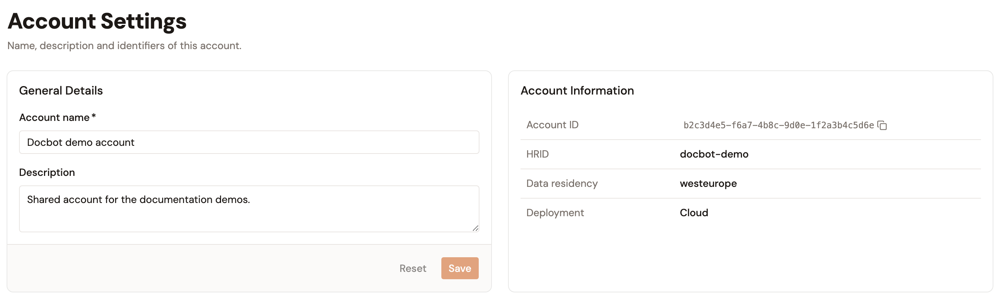
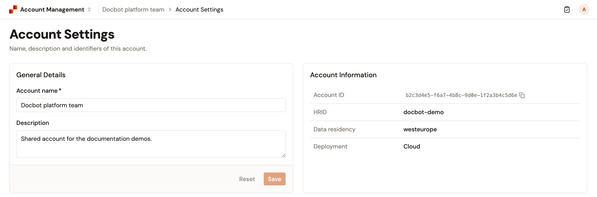

# Manage account settings in the Gamma console

## Overview

The **Account Settings** page of **Account Management** in the Gamma console shows the name, the description, and the identifiers of your Gravitee Cloud account. From this page, change the name and the description of the account.

What you do on the page depends on your role on the account:

* **Primary Owner** or **Account Owner**: view the page, and change the name and the description of the account.
* **Account User**: view the page only.

To open the Gamma console, see [Access your environments](../getting-started/access-your-environments.md).

## Open the Account Settings page

To open the **Account Settings** page, complete the following steps:

1. At the top of the Gamma console, click the name of the current app, for example **Home**.
2. Click **Account Management**.
3.  In the sidebar, click **Account Settings**.

    <figure><figcaption>
Account Settings page
</figcaption></figure>

The **Account Information** card shows the **Account ID**, the **HRID**, the **Data residency**, and the **Deployment** of the account, either **Cloud** or **Self-hosted**. A dash replaces a value the account doesn't have. To copy the account ID, click it.

## Change the name and the description of the account

To change the name or the description of the account, complete the following steps:

1. On the **Account Settings** page, in the **General Details** card, edit **Account name**, **Description**, or both.
2. Click **Save**.

The account name is required and takes 2 to 128 characters. The description takes up to 4,000 characters. To remove the description, clear the field. To discard your changes before you save them, click **Reset**.

After you save, the new name shows in the breadcrumbs at the top of the page and as the title of the **Overview** page.

## Verification

To verify the new name of the account is saved, follow these steps:

1. Refresh the **Account Settings** page in your browser.
2.  Check that **Account name** and the breadcrumbs at the top of the page show the new name.

    <figure><figcaption>
Account Settings page after the account was renamed
</figcaption></figure>
