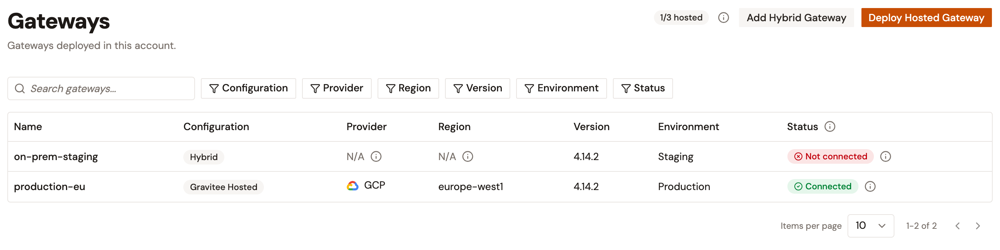
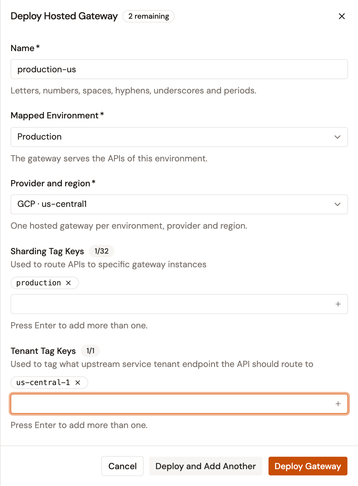
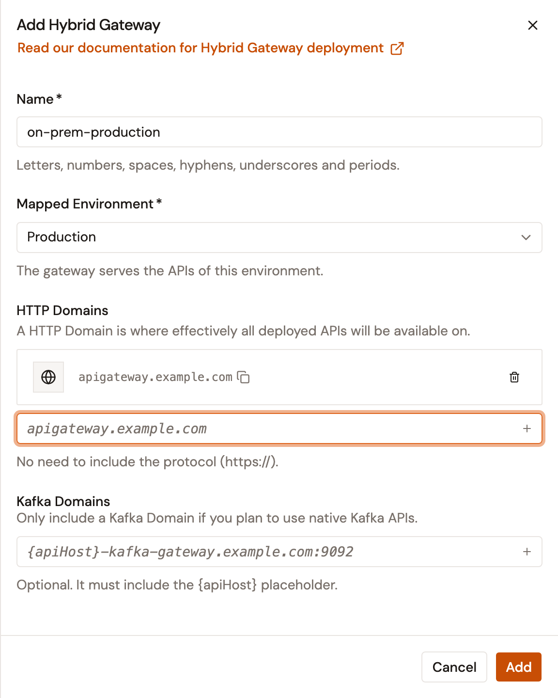
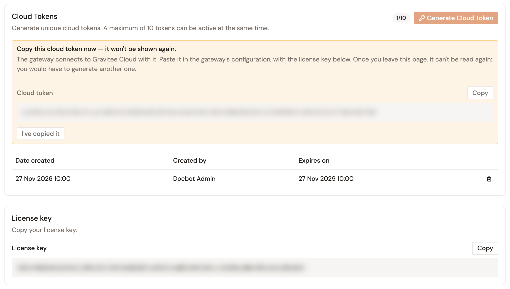
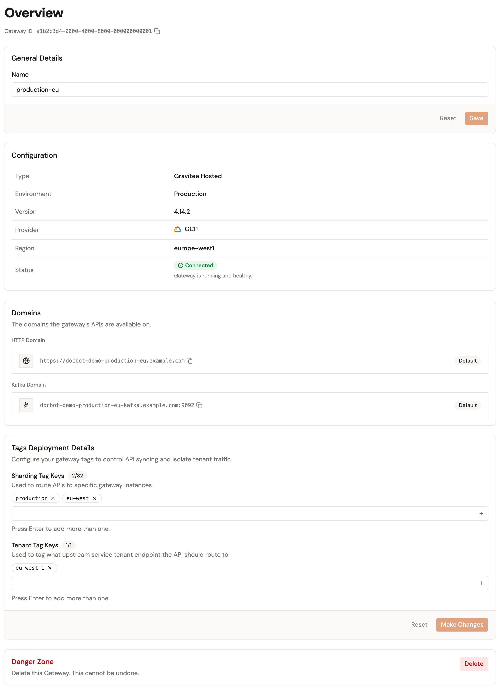

# Manage gateways in the Gamma console

<!-- TODO: CJ-5139 held for Gravitee Cloud 4.15. Re-read every label against the Account Management build that ships, and recapture if it changed, before merge. -->

## Overview

The **Gateways** page of Account Management in the Gamma console lists the gateways of your Gravitee Cloud account. On a Gravitee Cloud customer account, a **Primary Owner** or an **Account Owner** deploys Gravitee Hosted Gateways, adds Hybrid Gateways, and opens a gateway to view or change it. An **Account User** sees the list but can't open a gateway or add one.

## Open the Gateways page

To open the **Gateways** page, complete the following steps:

1. At the top of the Gamma console, click the name of the app you're in, for example **Home**.
2. Click **Account Management**.
3. In the sidebar, click **Gateways**.

The page lists each gateway with its **Configuration**, **Provider**, **Region**, **Version**, **Environment**, and **Status**. To find a gateway, type its name or any of its values in the search field, or filter the list with the button of each column. A Hybrid Gateway shows **N/A** for **Provider** and **Region**, because Gravitee Cloud doesn't read them from a gateway you run yourself. **Upgrade available** appears next to a version that differs from the version Gravitee Cloud runs. While a gateway shows **Pending**, the list refreshes on its own. Otherwise, reload the page to see the latest status.

The badge next to **Add Hybrid Gateway** shows how many of the Gravitee Hosted Gateways your plan allows are deployed, for example **1/3 hosted**.

<figure><figcaption>
Gateways page
</figcaption></figure>

## Deploy a Gravitee Hosted Gateway

Gravitee runs a Gravitee Hosted Gateway for you. Each environment has at most one Gravitee Hosted Gateway per provider and region.

To deploy a Gravitee Hosted Gateway, complete the following steps:

1. On the **Gateways** page, click **Deploy Hosted Gateway**. The panel title shows how many Gravitee Hosted Gateways your plan still allows.
2. In **Name**, enter a name for the gateway. The name has 2 to 128 characters: letters, numbers, spaces, hyphens, underscores, and periods.
3. In **Mapped Environment**, select the environment whose APIs the gateway serves.
4. In **Provider and region**, select where Gravitee runs the gateway. A provider and region that the environment already uses shows **Already deployed**.
5. Optional: In **Sharding Tag Keys**, enter a tag, and then press Enter or click the add icon. Repeat for each tag, up to 32.
6. Optional: In **Tenant Tag Keys**, enter one tag, and then press Enter or click the add icon.
7. Click **Deploy Gateway**. To deploy this gateway and start another one in the same panel, click **Deploy and Add Another** instead.

A tag has 2 to 64 characters: lowercase letters, numbers, and hyphens. It can't start or end with a hyphen or contain two hyphens in a row. A sharding tag that starts with `!` follows these rules after the `!`.

**Deploy Hosted Gateway** is unavailable in the following cases:

* Your account has no environment.
* No cloud provider is available to host a gateway.
* Your plan includes no Gravitee Hosted Gateways.
* You've deployed all the Gravitee Hosted Gateways your plan allows.
* Every environment already has a Gravitee Hosted Gateway on each provider and region.
* The gateway limit, the environments, the cloud providers, or the gateways couldn't be loaded.

Hover over the button to see the reason. To raise the limit, click **Contact Gravitee to Upgrade** on the banner that appears when you reach it.

<figure><figcaption>
Deploy Hosted Gateway panel
</figcaption></figure>

## Add a Hybrid Gateway

You run a Hybrid Gateway on your own infrastructure, and it connects to Gravitee Cloud with a cloud token and your license key.

To add a Hybrid Gateway, complete the following steps:

1. On the **Gateways** page, click **Add Hybrid Gateway**.
2. In **Name**, enter a name for the gateway.
3. In **Mapped Environment**, select the environment whose APIs the gateway serves.
4. In **HTTP Domains**, enter the domain where the gateway's APIs are available, without the protocol, and then press Enter or click the add icon. For example, `apigateway.example.com`.
5. In **Kafka Domains**, enter a domain only if you plan to use native Kafka APIs, and then press Enter or click the add icon. The domain must include the `{apiHost}` placeholder, for example, `{apiHost}-kafka-gateway.example.com:9092`.
6. Click **Add**.

**Add** stays unavailable until the gateway has a valid name, an environment, and at least one HTTP or Kafka domain. **Add Hybrid Gateway** is unavailable until your account has at least one environment.

<figure><figcaption>
Add Hybrid Gateway panel
</figcaption></figure>

The gateway's **Overview** page opens with a new cloud token in the **Cloud Tokens** section and your license key in the **License key** section. To connect the gateway, complete the following steps:

1. In the **Cloud Tokens** section, click **Copy** next to **Cloud token**. The token isn't shown again once you leave the page.
2. In the **License key** section, click **Copy**.
3. Paste the cloud token and the license key in the configuration of your gateway. For more information, see [Next-Gen Cloud hybrid installation](https://documentation.gravitee.io/apim/hybrid-installation-and-configuration-guides/next-gen-cloud).

A gateway has at most 10 active cloud tokens. To generate another one, click **Generate Cloud Token** on the gateway's **Overview** page.

<figure><figcaption>
Cloud token and license key of a new Hybrid Gateway
</figcaption></figure>

## View and edit a gateway

To open a gateway, click its name on the **Gateways** page. A gateway whose deployment failed can't be opened from the list. The gateway's **Overview** page shows the following sections:

* **General Details**: the gateway's name. To rename the gateway, change **Name**, and then click **Save**.
* **Configuration**: the gateway's **Type**, **Environment**, and **Version**, plus **Provider** and **Region** for a Gravitee Hosted Gateway, any other details Gravitee holds for the gateway, for example a **Transit Gateway ID**, and its **Status**.
* **Domains**: the HTTP and Kafka domains where the gateway's APIs are available. For a Hybrid Gateway, add or remove domains, and then click **Save**. The gateway keeps at least one domain.
* **Tags Deployment Details**: for a Gravitee Hosted Gateway, its sharding tags and tenant tag.
* **Cloud Tokens** and **License key**: for a Hybrid Gateway, its active cloud tokens and your license key.
* **Danger Zone**: deletes the gateway.

While Gravitee deploys a Gravitee Hosted Gateway, or when its deployment failed, its name and tags can't be changed. **Delete** is unavailable while Gravitee deploys the gateway.

<figure><figcaption>
Overview page of a Gravitee Hosted Gateway
</figcaption></figure>

### Change the tags of a Gravitee Hosted Gateway

Tag changes affect how APIs reach the gateway, and they're also applied in API Management.

To change the tags of a Gravitee Hosted Gateway, complete the following steps:

1. On the gateway's **Overview** page, scroll to the **Tags Deployment Details** section.
2. Add or remove tags in **Sharding Tag Keys** and **Tenant Tag Keys**.
3. Click **Make Changes**.
4. Review the tags added and removed, and then click **Yes, Apply Changes**.

While the tags are applied, the page shows **Gateway sync pending**, and the tags can't be changed again. If they aren't applied, the section shows **Gateway sync failed**. Click **Try Again**, and then click **Yes, Apply Changes**.

## Delete a gateway


Deleting a gateway can't be undone.


To delete a gateway, complete the following steps:

1. On the gateway's **Overview** page, scroll to the **Danger Zone** section.
2. Click **Delete**.
3. In the **Delete Gateway** dialog, type the gateway's name.
4. Click **Yes, delete it**.

## Verification

To verify that your gateway was added, follow these steps:

1. In the sidebar of Account Management, click **Gateways**.
2. Your gateway appears in the list. A Gravitee Hosted Gateway shows **Pending** next to its name until Gravitee has deployed it. If the deployment fails, it shows **Failed**: contact Gravitee for support. A Hybrid Gateway shows **Not connected** until it connects with its cloud token.
